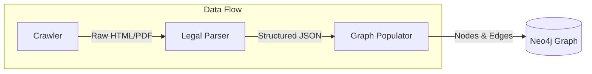
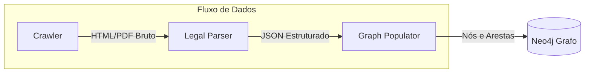

# LegisGraph: Knowledge Graph for Brazilian Legislation

> **Course Completion Work (TCC) / Trabalho de Conclusão de Curso (TCC)**
>
> *Universidade [Nome da Universidade if known, otherwise generic]*
> *Student: [Your Name]*

## 🌍 Language Selection / Seleção de Idioma

Please select your preferred language to read the documentation:
Por favor, selecione seu idioma de preferência para ler a documentação:

- [🇺🇸 **English Version**](#-english-version)
- [🇧🇷 **Versão em Português**](#-versão-em-português)

---

## 🇺🇸 English Version

### 🎯 Abstract
The **LegisGraph** project aims to build a structured knowledge graph of Brazilian federal legislation (Planalto.gov.br). The central objective is to create a rich, graph-based data structure to enhance **Retrieval-Augmented Generation (RAG)** systems, overcoming the limitations of traditional vector-based search in legal contexts.

### �️ Architecture
The system is composed of three modular components designed for scalability and precision:

### 🧩 Components

1.  **[Crawler](./crawler)**:
    - Responsible for traversing the Planalto.gov.br portal.
    - Captures the delicate hierarchical context of hyperlinks (e.g., preserving that a link originates specifically from "Art. 2, § 3").
    - Archives raw HTML and PDF content with comprehensive metadata.

2.  **[Legal-Parser](./legal-parser)**:
    - A specialized parser that converts raw legal text into structured JSON objects.
    - Algorithms designed to extract deep hierarchy (Article, Paragraph, Inciso, Alínea).
    - Outputs standardized data ready for graph ingestion.

3.  **[Graph-Populator](./graph-populator)**:
    - The ingestion engine for the Neo4j database.
    - Models the complex web of Brazilian legislation into nodes (`Law`, `Article`) and relationships (`:CONTEM`).
    - Ensures data integrity and idempotent execution.

### 🚀 Key Contributions
- **Hierarchical Context Tracking**: Solves the "lost context" problem in legal RAG by preserving the exact provenance of every text segment.
- **Canonical Identification**: Implements a robust ID system (e.g., `lei-federal-8078-1990`) to ensure uniqueness across the graph.
- **Graph-Native Design**: Architected specifically to leverage the traversal capabilities of Neo4j for complex legal queries.

---

## 🇧🇷 Versão em Português

### 🎯 Resumo
O projeto **LegisGraph** tem como objetivo construir um grafo de conhecimento estruturado da legislação federal brasileira (Planalto.gov.br). O objetivo central é criar uma estrutura de dados baseada em grafos para aprimorar sistemas de **Geração Aumentada por Recuperação (RAG)**, superando as limitações da busca vetorial tradicional em contextos jurídicos.

### 🏛️ Arquitetura
O sistema é composto por três componentes modulares projetados para escalabilidade e precisão:

### 🧩 Componentes

1.  **[Crawler](./crawler)**:
    - Responsável por navegar no portal Planalto.gov.br.
    - Captura o contexto hierárquico delicado dos hiperlinks (ex: preserva que um link se origina especificamente do "Art. 2º, § 3º").
    - Arquiva conteúdo bruto (HTML/PDF) com metadados abrangentes.

2.  **[Legal-Parser](./legal-parser)**:
    - Um parser especializado que converte texto legal bruto em objetos JSON estruturados.
    - Algoritmos projetados para extrair a hierarquia profunda (Artigo, Parágrafo, Inciso, Alínea).
    - Gera dados padronizados prontos para ingestão no grafo.

3.  **[Graph-Populator](./graph-populator)**:
    - O motor de ingestão para o banco de dados Neo4j.
    - Modela a complexa teia da legislação brasileira em nós (`Lei`, `Artigo`) e relacionamentos (`:CONTEM`).
    - Garante a integridade dos dados e execução idempotente.

### 🚀 Principais Contribuições
- **Rastreamento de Contexto Hierárquico**: Resolve o problema de "perda de contexto" em RAG jurídico, preservando a proveniência exata de cada segmento de texto.
- **Identificação Canônica**: Implementa um sistema robusto de IDs (ex: `lei-federal-8078-1990`) para garantir unicidade em todo o grafo.
- **Design Nativo para Grafos**: Arquitetado especificamente para alavancar as capacidades de travessia do Neo4j para consultas jurídicas complexas.
