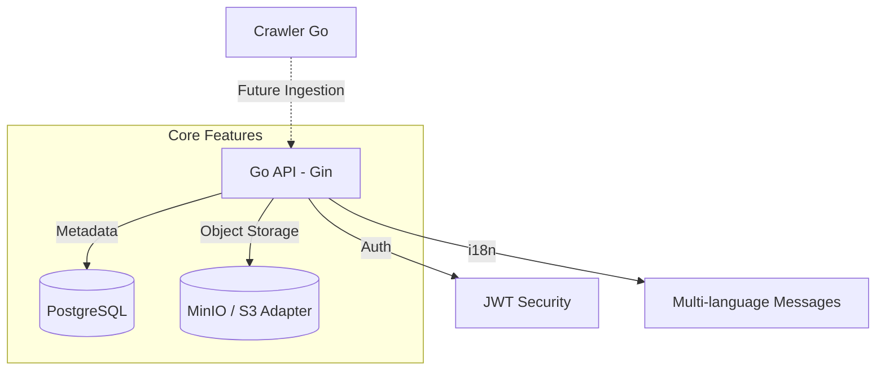
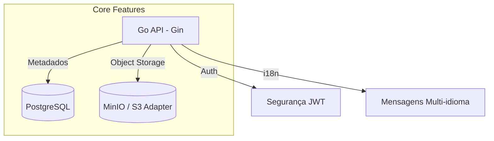

  

  <h1>ThingIndex: Knowledge Graph for Brazilian Legislation</h1>
  
<b>Course / Curso:</b> Sistemas de Informação

  
<b>Author / Autor:</b> Charles Eduardo Mello Guimarães

  
<b>Trabalho de Conclusão de Curso (TCC)</b>

 

🇺🇸 <b>English Version / Versão em Inglês</b>

## 🎯 Abstract
The **ThingIndex** project aims to build a structured knowledge graph of Brazilian federal legislation (Planalto.gov.br). The central objective is to create a rich, graph-based data structure to enhance **Retrieval-Augmented Generation (RAG)** systems, overcoming the limitations of traditional vector-based search in legal contexts.

## 🏛️ Architecture
The system is composed of modular components designed for scalability, precision, and privacy:

## 🧩 Components

1.  **[API (Go / Gin)](./api)**:
    *   **Architecture**: Clean Architecture with decoupled layers (Domain, UseCase, Repository, Handler).
    *   **Storage**: Implements the **Adapter Pattern** for object storage. Currently supports **MinIO**, but ready for AWS S3 or GCP Cloud Storage.
    *   **Internationalization (i18n)**: Full support for translated error and success messages (PT/EN).
    *   **Security**: JWT-based authentication with user-scoped data isolation. Each user manages their own documents and categories.

2.  **[Document Management](./api/internal/handlers/document.go)**:
    *   Handles `multipart/form-data` uploads.
    *   Automatic and manual categorization.
    *   Metadata tracking (size, type, status) ready for graph mapping.

3.  **[Crawler (Go)](./crawler)**:
    *   Responsible for traversing the Planalto.gov.br portal.
    *   Captures the delicate hierarchical context of hyperlinks.
    *   Archives raw content with comprehensive metadata.

## 🚀 Key Contributions
- **Decoupled Object Storage**: Swap storage providers without touching business logic.
- **Privacy-First**: Rigorous UserID scoping for all legal documents and categories.
- **Graph-Ready**: Models architected to be transformed into Neo4j nodes (`Law`, `Article`) and relationships (`:CONTEM`).

🇧🇷 <b>Portuguese Version / Versão em Português</b>

## 🎯 Resumo
O projeto **ThingIndex** tem como objetivo construir um grafo de conhecimento estruturado da legislação federal brasileira (Planalto.gov.br). O central da ideia é criar uma estrutura de dados baseada em grafos rica, aprimorando sistemas de **RAG (Retrieval-Augmented Generation)** e superando as limitações da busca vetorial tradicional em contextos jurídicos precisos.

## 🏛️ Arquitetura
O sistema é composto de módulos independentes projetados para escala, precisão e privacidade:

## 🧩 Componentes e Ferramentas

1.  **[API (Go / Gin)](./api)**:
    *   **Arquitetura**: Clean Architecture com camadas desacopladas (Domínio, UseCase, Repositório, Handler).
    *   **Storage**: Implementa o **Adapter Pattern** para armazenamento de objetos. Atualmente utiliza **MinIO**, mas está pronto para AWS S3 ou GCP.
    *   **Internacionalização (i18n)**: Suporte total para mensagens de erro e sucesso traduzidas (PT/EN).
    *   **Segurança**: Autenticação via JWT com isolamento de dados por usuário.

2.  **[Gestão de Documentos](./api/internal/handlers/document.go)**:
    *   Upload via `multipart/form-data`.
    *   Categorização automática e manual.
    *   Rastreamento de metadados prontos para o mapeamento em grafos.

3.  **[Crawler (Golang)](./crawler)**:
    *   Navegação inteligente pelo portal Planalto.gov.br.
    *   Controle de contexto: sabe exatamente de qual Artigo/Parágrafo um link foi originado.

## 🚀 Principais Contribuições
- **Storage Desacoplado**: Troque o provedor de nuvem sem alterar uma linha de lógica de negócio.
- **Privacidade**: Scoping rigoroso por `UserID` para todos os documentos e categorias.
- **Pronto para Grafos**: Modelos pensados para serem transformados em Nós (`Lei`, `Artigo`) e relacionamentos no Neo4j.

