<div align="center">


# ThingIndex

### Inteligência Documental com Proveniência Verificável sobre Modelo Relacional

Trabalho de Conclusão de Curso · Sistemas de Informação · IFPR Campus Palmas · 2026<br/>
**Charles Eduardo Mello Guimarães**

<br/>

[Artigo (PDF)](docs/article/ThingIndex-artigo.pdf) · [Anexos](#anexos) · [Como executar](#como-executar)

Go · Next.js · PostgreSQL · RabbitMQ · Licença MIT

</div>

---

O **ThingIndex** responde perguntas sobre coleções de PDFs, como leis, normas e manuais, e
mostra **de onde veio cada resposta**: o documento e a página, com o parágrafo destacado no
próprio PDF.

Cada parte do documento (página, parágrafo, linha de tabela, seção do sumário) é uma linha
de tabela no PostgreSQL, ligada ao documento por chave estrangeira e com a página de origem.
A busca é por palavras (BM25), sem banco vetorial. Na pergunta, o LLM só entra no fim, para redigir a
resposta a partir das fontes que a busca escolheu. Por isso a página mostrada ao usuário vem
do banco, e não do texto escrito pelo modelo.

> **Pergunta de pesquisa:** *é possível sustentar um sistema de inteligência documental com
> auditabilidade utilizando exclusivamente modelagem relacional, sem depender de bancos
> vetoriais ou grafos como camada primária de recuperação?*

<p align="center">
  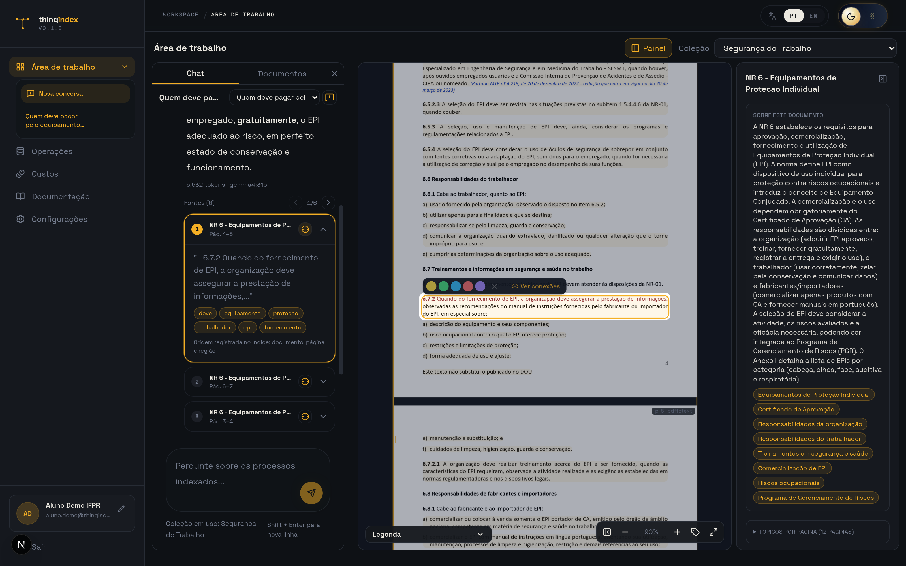
  <br/>
  <sub>Workspace de uma coleção de normas de segurança do trabalho: chat com as fontes numeradas, PDF na página citada com o parágrafo destacado e resumo do documento.</sub>
</p>

## Sumário

- [O artigo](#o-artigo)
- [Resultados](#resultados)
- [Anexos](#anexos)
- [O sistema em telas](#o-sistema-em-telas)
- [Como funciona](#como-funciona)
- [Como executar](#como-executar)
- [Testes](#testes)
- [Reproduzir o artigo](#reproduzir-o-artigo)
- [Estrutura do repositório](#estrutura-do-repositório)
- [Como citar](#como-citar)

## O artigo

<p align="center">
  <a href="docs/article/ThingIndex-artigo.pdf">
    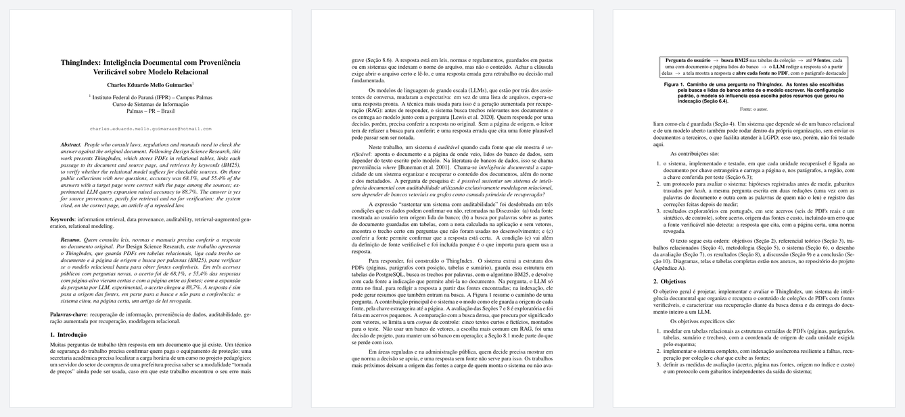
  </a>
  <br/>
  <a href="docs/article/ThingIndex-artigo.pdf"><b>Abrir o artigo completo (PDF, 28 páginas)</b></a>
</p>

O trabalho segue a *Design Science Research*: o ThingIndex foi construído e avaliado em sete
acervos em português, seis de PDFs públicos reais (documentos do IFPR, leis, Normas
Regulamentadoras, manuais e um edital) e um de controle, com cerca de 870 páginas no total.
As hipóteses foram registradas antes de medir, os gabaritos ficam travados por *hash* e
toda correção feita depois da medição está registrada no [Anexo A8](anexos/A8-alteracoes-pos-medicao.pdf).

A fonte LaTeX está em [`docs/article/artigo.tex`](docs/article/artigo.tex).

## Resultados

| Pergunta | Resultado |
|---|---|
| Busca por palavras ou por significado: qual acha mais? | Ficaram próximas: 13 de 16 contra 11 de 16 consultas, sem diferença detectável |
| Buscar trechos custa menos que mandar o PDF inteiro ao modelo? | Sim, no acervo de desenvolvimento: na mediana das perguntas com resposta, cerca de 9 vezes menos *tokens*, com 71 de 72 perguntas certas nos dois casos (configurações diferentes entre os dois) |
| Quanto o sistema acerta em perguntas novas? | 68,1% das respostas, cerca de 7 em 10; 55,4% das respostas com página-alvo estavam certas e com a página certa entre as fontes |
| A redação da pergunta muda o acerto? | Sim: 88,2% com as palavras do documento e 38,7% com outras palavras |
| Expandir a pergunta com um LLM ajuda? | De 68,1% para 88,7% (experimental, desligada por padrão) |
| Fonte certa garante resposta certa? | Não: o sistema citou, com a página certa, o artigo de uma lei revogada |

As ressalvas de cada número e a resposta à pergunta de pesquisa, condição por condição,
estão nas Seções 8 e 9 do artigo.

## Anexos

Os diagramas, as telas e as tabelas completas ficam fora do artigo, por causa do limite de
páginas. Clique em um anexo para abrir o PDF.

<table>
  <tr>
    <td align="center" width="20%"><a href="anexos/A1-requisitos-funcionais.pdf">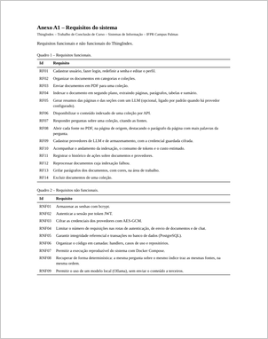</a><br/><b>A1</b><br/><sub>Requisitos funcionais e não funcionais</sub></td>
    <td align="center" width="20%"><a href="anexos/A2-casos-de-uso.pdf">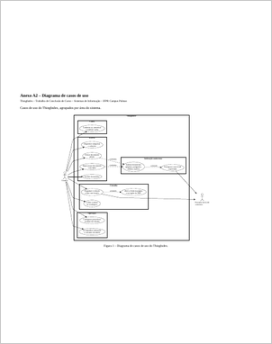</a><br/><b>A2</b><br/><sub>Casos de uso</sub></td>
    <td align="center" width="20%"><a href="anexos/A3-sequencia-envio-e-pergunta.pdf">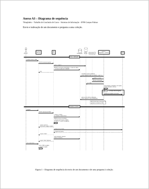</a><br/><b>A3</b><br/><sub>Sequência: envio de um documento e uma pergunta</sub></td>
    <td align="center" width="20%"><a href="anexos/A4-esquema-proveniencia.pdf">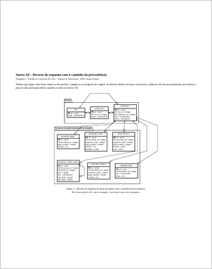</a><br/><b>A4</b><br/><sub>Tabelas que ligam cada fonte ao documento e à página</sub></td>
    <td align="center" width="20%"><a href="anexos/A5-fluxo-de-recuperacao.pdf">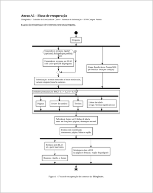</a><br/><b>A5</b><br/><sub>Fluxo de recuperação</sub></td>
  </tr>
  <tr>
    <td align="center"><a href="anexos/A6-telas-do-prototipo.pdf">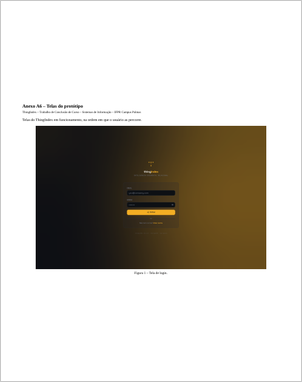</a><br/><b>A6</b><br/><sub>Telas do sistema</sub></td>
    <td align="center"><a href="anexos/A7-tabelas-completas-de-recuperacao.pdf">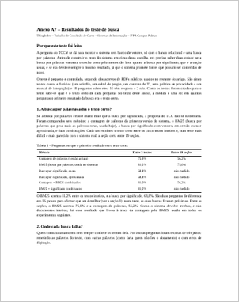</a><br/><b>A7</b><br/><sub>Tabelas completas do teste de busca</sub></td>
    <td align="center"><a href="anexos/A8-alteracoes-pos-medicao.pdf">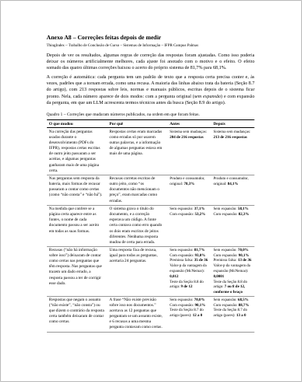</a><br/><b>A8</b><br/><sub>Correções feitas depois de medir</sub></td>
    <td align="center"><a href="anexos/A9-esquema-do-banco.pdf">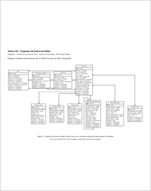</a><br/><b>A9</b><br/><sub>Esquema completo do banco (25 tabelas)</sub></td>
    <td align="center"><a href="anexos/A10-acervos/README.md">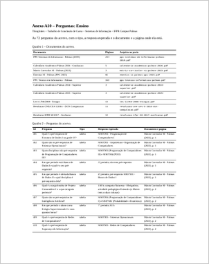</a><br/><b>A10</b><br/><sub>Acervos: os PDFs indexados e as perguntas</sub></td>
  </tr>
</table>

O A10 é uma pasta por acervo, com os PDFs que o sistema indexou e um `perguntas.pdf` com
todas as perguntas, a resposta esperada e a página onde ela está:
[controle C1](anexos/A10-acervos/01-controle-c1/) ·
[ensino](anexos/A10-acervos/02-ensino/) ·
[legislação](anexos/A10-acervos/03-legislacao/) ·
[segurança do trabalho](anexos/A10-acervos/04-seguranca-do-trabalho/) ·
[produto e consumidor](anexos/A10-acervos/05-produto-e-consumidor/) ·
[licitações](anexos/A10-acervos/06-licitacoes/) ·
[edital municipal](anexos/A10-acervos/07-edital-municipal/).

## O sistema em telas

<table>
  <tr>
    <td width="50%">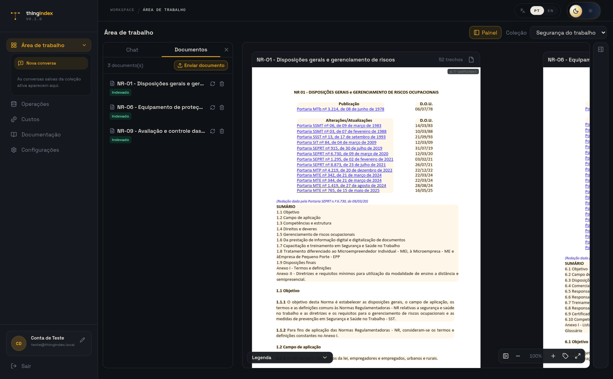<br/><sub><b>Área de trabalho</b> · documentos indexados da coleção</sub></td>
    <td width="50%">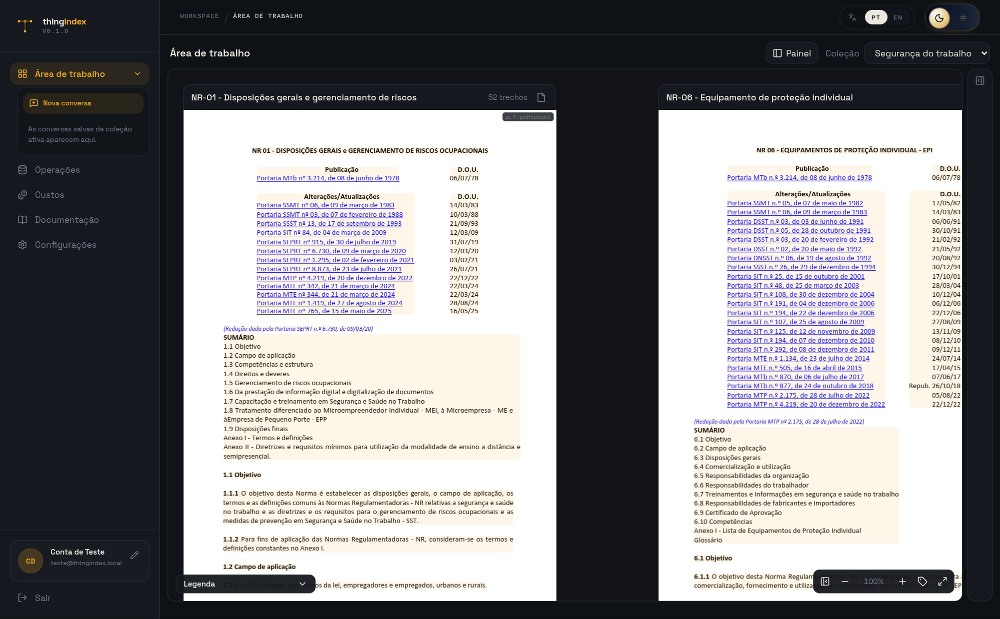<br/><sub><b>Leitura</b> · PDFs da coleção abertos lado a lado</sub></td>
  </tr>
  <tr>
    <td>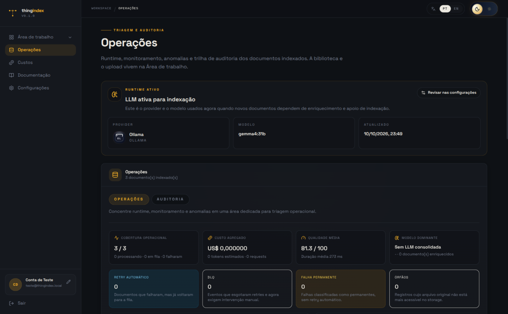<br/><sub><b>Operações</b> · andamento da indexação</sub></td>
    <td>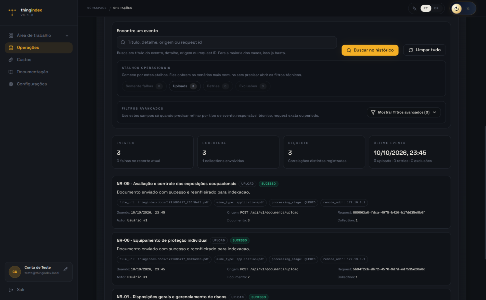<br/><sub><b>Auditoria</b> · trilha de eventos dos documentos</sub></td>
  </tr>
  <tr>
    <td>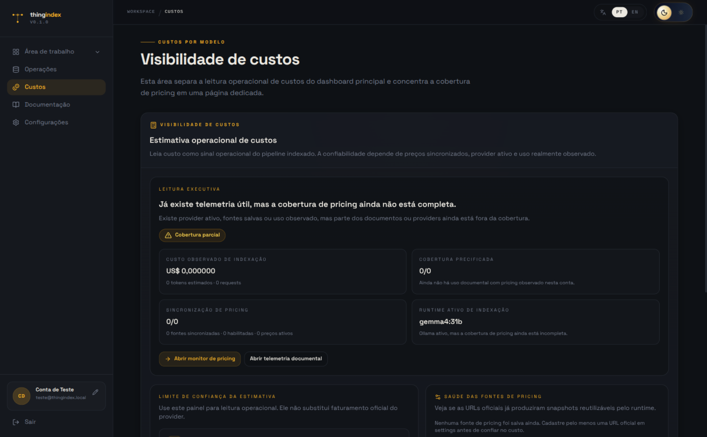<br/><sub><b>Custos</b> · consumo de <i>tokens</i> e custo estimado</sub></td>
    <td>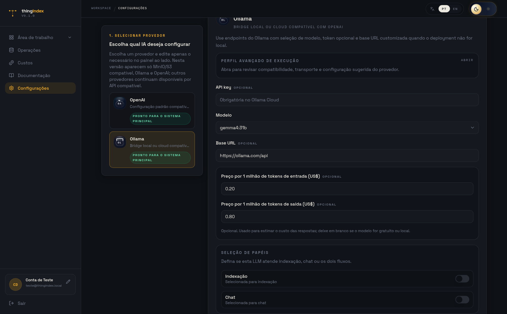<br/><sub><b>Provedores</b> · modelo, URL e preço por milhão de <i>tokens</i></sub></td>
  </tr>
</table>

Todas as telas estão no [Anexo A6](anexos/A6-telas-do-prototipo.pdf).

## Como funciona

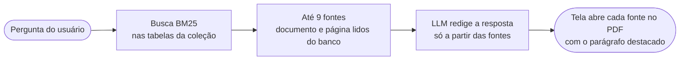

O modelo não escolhe as fontes: elas vêm da busca e do banco antes de ele escrever. Na configuração padrão, ele só influencia a busca pelos resumos que gerou na indexação.

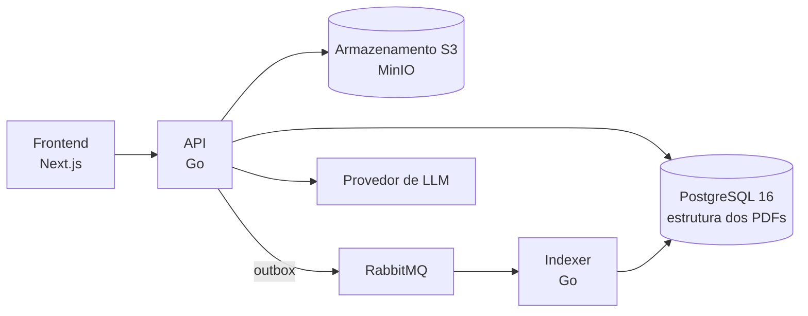

No envio, a API grava o documento e o pedido de indexação na mesma transação (*outbox*); um
despachante publica o pedido no RabbitMQ, e o *indexer* extrai páginas, parágrafos com
posição, tabelas e sumário. Um teste de caos derruba a fila, o banco e o armazenamento com o
sistema em uso e confere que ele volta sozinho.

| Parte | Tecnologia |
|---|---|
| Frontend | Next.js 16 e React 19 |
| API e indexer | Go, com Gin e GORM |
| Banco | PostgreSQL 16 |
| Fila | RabbitMQ |
| Arquivos | armazenamento compatível com S3 (MinIO no ambiente local) |
| LLM | provedor configurável (os experimentos usaram Ollama) |

## Como executar

Pré-requisitos: Docker e Docker Compose v2.

```bash
cp .env.example .env        # ajuste as variáveis, se precisar
./scripts/bootstrap.sh
./scripts/stack.sh up       # ou ./scripts/stack.sh dev, com hot reload
./scripts/doctor.sh         # confere se os serviços estão de pé
```

| Serviço | Endereço |
|---|---|
| Frontend | http://localhost:3000 |
| API | http://localhost:8000 |
| Documentação da API | http://localhost:8000/docs |
| Console do MinIO | http://localhost:9001 |
| RabbitMQ | http://localhost:15672 |
| PostgreSQL | localhost:5434 |

Depois de criar uma conta, cadastre um provedor de LLM em **Configurações** (modelo, URL e,
para acompanhar o custo, o preço por milhão de *tokens*), crie uma coleção e envie os PDFs.

<details>
<summary><b>Rodar a API e o frontend fora do Docker</b></summary>

<br/>

Suba só a infraestrutura e rode cada parte num terminal:

```bash
./scripts/stack.sh core
cd api && go run ./cmd/api
cd frontend && pnpm install && pnpm dev
```

No `.env`, aponte `DB_HOST`, `DB_PORT` e `MINIO_ENDPOINT` para `localhost`. Requer Go 1.26,
Node.js 20 e `pnpm`.

</details>

## Testes

```bash
./scripts/test.sh unit                  # unitários do backend e do frontend
./scripts/test.sh backend-integration   # contra PostgreSQL, RabbitMQ e MinIO reais
./scripts/test.sh frontend-e2e          # interface no navegador (Playwright)
./scripts/teste-caos.sh                 # derruba fila, banco e armazenamento com o sistema rodando
```

## Reproduzir o artigo

| O quê | Onde |
|---|---|
| Resultados brutos, uma linha por pergunta e repetição | [`docs/article/results/`](docs/article/results/) |
| Gabaritos de cada acervo, travados por *hash* | [`api/internal/evalcorpus/testdata/`](api/internal/evalcorpus/testdata/) |
| Tabelas geradas a partir dos resultados | [`docs/article/tables/`](docs/article/tables/) |
| Conferência dos números do texto contra os resultados | [`scripts/check-article-numbers.py`](scripts/check-article-numbers.py) |
| Geração dos anexos | [`scripts/gerar-anexos.py`](scripts/gerar-anexos.py) |

## Estrutura do repositório

```text
api/           API, indexer e ferramentas de avaliação (Go)
frontend/      interface web (Next.js)
anexos/        anexos do artigo, em PDF
docs/article/  artigo, resultados, tabelas e imagens
examples/      PDFs usados na avaliação
scripts/       execução, testes, experimentos e conferência do artigo
```

## Como citar

```bibtex
@misc{guimaraes2026thingindex,
  author       = {Guimarães, Charles Eduardo Mello},
  title        = {ThingIndex: Inteligência Documental com Proveniência Verificável sobre Modelo Relacional},
  howpublished = {Trabalho de Conclusão de Curso (Sistemas de Informação), Instituto Federal do Paraná, Campus Palmas},
  year         = {2026},
  url          = {https://github.com/EduardoMG12/ThingIndex}
}
```

## Uso de inteligência artificial

Durante o desenvolvimento do sistema e a preparação do artigo, o autor utilizou as ferramentas
de inteligência artificial generativa Claude (Anthropic) e ChatGPT (OpenAI) para auxiliar na
programação, na revisão da escrita acadêmica, na estruturação das seções, na tradução do resumo
e na melhoria geral da redação. A pergunta de pesquisa, o desenho dos experimentos, os
gabaritos e as decisões técnicas são do autor, que revisou todo o conteúdo e assume plena
responsabilidade por ele.

## Licença

[MIT](LICENSE).
