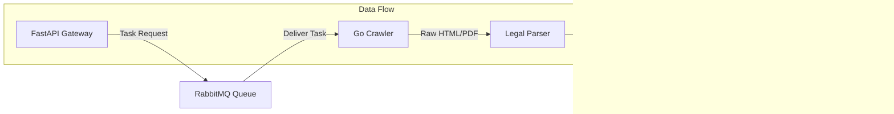
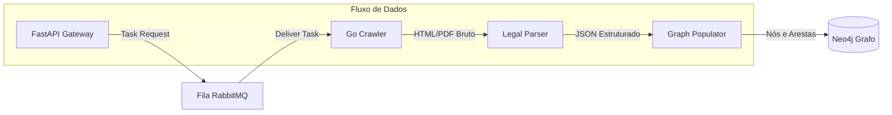

  

  <h1>ThingIndex: Knowledge Graph for Brazilian Legislation</h1>
  
<b>Course / Curso:</b> Sistemas de Informação

  
<b>Author / Autor:</b> Charles Eduardo Mello Guimarães

  
<b>Trabalho de Conclusão de Curso (TCC)</b>

 

🇺🇸 <b>English Version / Versão em Inglês</b>

## 🎯 Abstract
The **ThingIndex** project aims to build a structured knowledge graph of Brazilian federal legislation (Planalto.gov.br). The central objective is to create a rich, graph-based data structure to enhance **Retrieval-Augmented Generation (RAG)** systems, overcoming the limitations of traditional vector-based search in legal contexts.

## 🏛️ Architecture
The system is composed of three modular components designed for scalability and precision:

## 🧩 Components

1.  **[API (FastAPI)](./api)**:
    - Provides a modern REST gateway and interactive Swagger/Scalar docs.
    - Triggers the crawler asynchronously via messages.

2.  **[Crawler (Go)](./crawler)**:
    - Responsible for traversing the Planalto.gov.br portal.
    - Captures the delicate hierarchical context of hyperlinks (e.g., preserving that a link originates specifically from "Art. 2, § 3").
    - Archives raw HTML and PDF content with comprehensive metadata.

3.  **[Legal-Parser](./legal-parser)**:
    - A specialized parser that converts raw legal text into structured JSON objects.
    - Algorithms designed to extract deep hierarchy (Article, Paragraph, Inciso, Alínea).
    - Outputs standardized data ready for graph ingestion.

4.  **[Graph-Populator](./graph-populator)**:
    - The ingestion engine for the Neo4j database.
    - Models the complex web of Brazilian legislation into nodes (`Law`, `Article`) and relationships (`:CONTEM`).
    - Ensures data integrity and idempotent execution.

## 🚀 Key Contributions
- **Hierarchical Context Tracking**: Solves the "lost context" problem in legal RAG by preserving the exact provenance of every text segment.
- **Canonical Identification**: Implements a robust ID system (e.g., `lei-federal-8078-1990`) to ensure uniqueness across the graph.
- **Graph-Native Design**: Architected specifically to leverage the traversal capabilities of Neo4j for complex legal queries.

🇧🇷 <b>Portuguese Version / Versão em Português</b>

## 🎯 Resumo
O projeto **ThingIndex** tem como objetivo construir um grafo de conhecimento estruturado da legislação federal brasileira (Planalto.gov.br). O central da ideia é criar uma estrutura de dados baseada em grafos rica, aprimorando sistemas de **RAG (Retrieval-Augmented Generation)** e superando as limitações da busca vetorial tradicional em contextos jurídicos precisos.

## 🏛️ Arquitetura
O sistema é composto de módulos independentes projetados para escala e precisão:

## 🧩 Componentes e Ferramentas

1.  **[API (FastAPI Python)](./api)**:
    - Um gateway REST moderno fornecendo a documentação interativa (Scalar).
    - Dispara as tarefas de navegação pela mensageria (RabbitMQ).

2.  **[Crawler (Golang)](./crawler)**:
    - Fica ouvindo na fila as missões de navegação do Planalto.gov.br.
    - Tem controle rigoroso de contexto: lembra exatamente que um link foi originado do "Art. 2º, § 3º".
    - Salva HTML/PDF e rastreia os relacionamentos.

3.  **[Legal-Parser](./legal-parser)**:
    - Módulo que converte texto legal bruto para objetos JSON bem consolidados.
    - Possui algoritmos de extração profunda da hierarquia brasileira (Títulos, Capítulos, Seções, Artigos, Parágrafos).

4.  **[Graph-Populator](./graph-populator)**:
    - O motor de ingestão no banco de dados **Neo4j**.
    - Transforma as leis estruturadas em Nós (`Lei`, `Artigo`) e relacionamentos de grafos.

## 🚀 Principais Contribuições
- **Rastreamento e Árvore de Contexto**: Resolve o problema de fragmentação em RAG injetando de qual Artigo aquele texto derivou.
- **Identificadores Canônicos Estritos**: Fornece UUIDs contextuais consistentes (Ex: `lei-federal-8078-1990`).
- **Arquitetura Orientada a Grafos**: Permite a travessia veloz nas malhas da teia jurídica brasileira.

