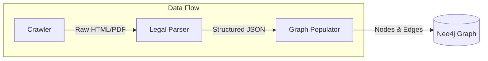

# LegisGraph: Knowledge Graph for Brazilian Legislation (TCC)

> **Course Completion Work (TCC) / Trabalho de Conclusão de Curso (TCC)**
>
> 🇺🇸 A structured knowledge graph of Brazilian federal legislation to improve AI/RAG responses.
>
> 🇧🇷 Um grafo de conhecimento estruturado da legislação federal brasileira para melhorar respostas de IA/RAG.

## 🏗️ Architecture / Arquitetura

---

## 🇺🇸 English Documentation

### 🎯 Objective
The goal is to create a rich data structure to improve **RAG (Retrieval-Augmented Generation)**. Traditional vector search loses hierarchical context (e.g., "Art. 5 is valid, but paragraph 2 was revoked by Law Y"). LegisGraph preserves this structure to enable accurate legal reasoning.

### 🧩 Components

1.  **[Crawler](./crawler)**:
    - Traverses Planalto.gov.br.
    - Captures hierarchical context of links.
    - Downloads raw content.

2.  **[Legal-Parser](./legal-parser)**:
    - Processes raw documents into structured JSON.
    - Extracts hierarchy (Art., §, Inciso, Alínea).
    - Outputs standardized JSON.

3.  **[Graph-Populator](./graph-populator)**:
    - Ingests processed JSON into Neo4j.
    - Creates the graph nodes (`Law`, `Article`, etc.) and `:CONTEM` relationships.
    - Verifies data integrity.

### 🚀 Key Features
- **Hierarchical Context Tracking**: Preserves the exact location of origin for every piece of text.
- **Canonical IDs**: Unique identifiers for every legal element.
- **Graph-Native**: Designed for Neo4j from the ground up.

---

## 🇧🇷 Documentação em Português

### 🎯 Objetivo
O objetivo é criar uma estrutura de dados rica para melhorar o **RAG (Geração Aumentada por Recuperação)**. A busca vetorial tradicional perde o contexto hierárquico (ex: "O Art. 5 é válido, mas o parágrafo 2 foi revogado pela Lei Y"). O LegisGraph preserva essa estrutura para permitir raciocínio jurídico preciso.

### 🧩 Componentes

1.  **[Crawler](./crawler)**:
    - Navega pelo Planalto.gov.br.
    - Captura o contexto hierárquico dos links.
    - Baixa o conteúdo bruto.

2.  **[Legal-Parser](./legal-parser)**:
    - Processa documentos brutos em JSON estruturado.
    - Extrai a hierarquia (Art., §, Inciso, Alínea).
    - Gera JSON padronizado.

3.  **[Graph-Populator](./graph-populator)**:
    - Ingere o JSON processado no Neo4j.
    - Cria os nós do grafo (`Lei`, `Artigo`, etc.) e relacionamentos `:CONTEM`.
    - Verifica a integridade dos dados.

### 🚀 Principais Funcionalidades
- **Rastreamento de Contexto Hierárquico**: Preserva a localização exata de origem de cada texto.
- **IDs Canônicos**: Identificadores únicos para cada elemento legal.
- **Nativo para Grafos**: Desenhado para Neo4j desde o início.
