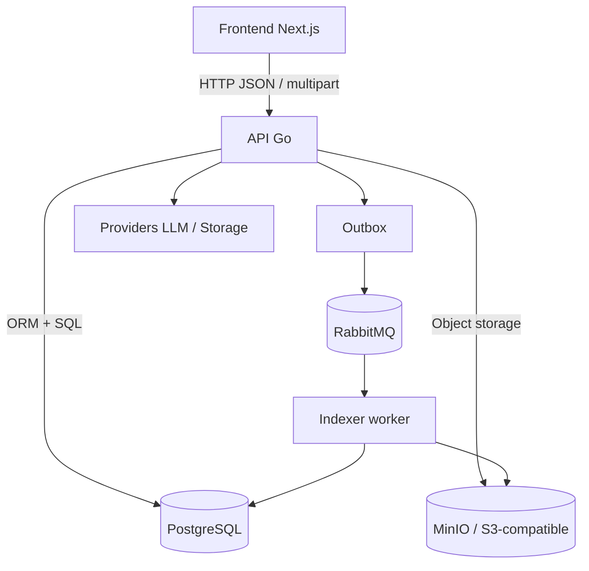
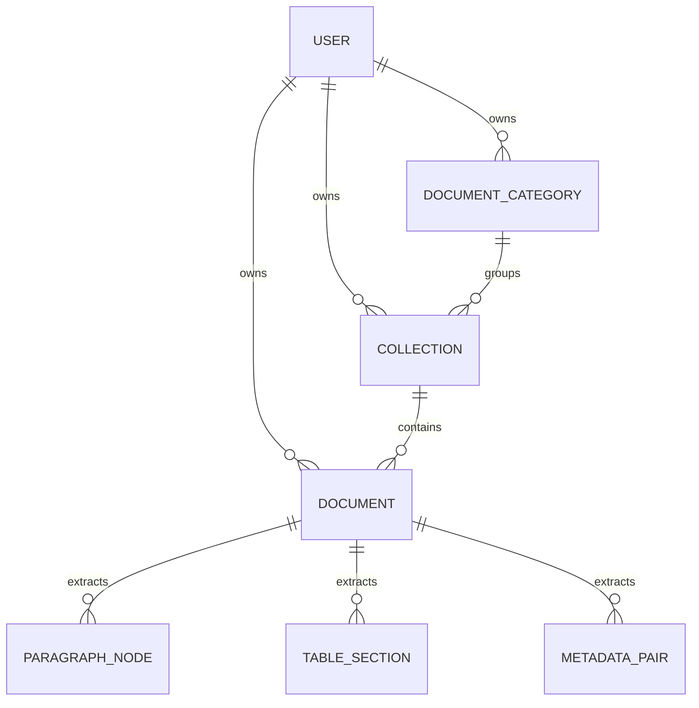

# ThingIndex: Plataforma Relacional de Inteligência Documental para Contexto Auditável

**Charles Eduardo Mello Guimaraes**  
Instituto Federal do Paraná (IFPR) - Campus Palmas  
Curso de Sistemas de Informação  
Palmas - PR - Brasil  
charles@example.com

**Resumo.** Este artigo apresenta o ThingIndex, uma plataforma documental desenvolvida com foco em organização relacional, extração estruturada e recuperação de contexto auditável. Em vez de assumir busca vetorial ou banco de grafos como núcleo obrigatório, o sistema utiliza modelagem relacional explícita em PostgreSQL, armazenamento S3-compatible e processamento assíncrono para manter coleções documentais, metadados e estruturas extraídas conectados de forma rastreável. O trabalho descreve a arquitetura implementada, o fluxo operacional atual e o recorte acadêmico adotado no TCC. O argumento central é que uma baseline relacional bem modelada já consegue oferecer valor prático e base experimental consistente para comparações futuras com abordagens vetoriais e GraphRAG.

**Abstract.** This paper presents ThingIndex, a document-intelligence platform focused on relational organization, structured extraction, and auditable context recovery. Instead of assuming vector retrieval or graph databases as mandatory core components, the system relies on explicit relational modeling in PostgreSQL, S3-compatible storage, and asynchronous processing to keep document collections, metadata, and extracted structures connected in a traceable way. The paper describes the implemented architecture, the current operational flow, and the academic framing adopted in the capstone project. The central argument is that a well-modeled relational baseline can already deliver practical value and provide a consistent experimental baseline for future comparisons against vector and GraphRAG approaches.

## 1. Introdução

Sistemas documentais costumam sofrer com duas limitações recorrentes. A primeira é a organização insuficiente do contexto entre arquivos relacionados. A segunda é a dependência excessiva de pipelines externos de recuperação e resposta, o que dificulta auditoria, previsibilidade de custo e defesa técnica da solução. Em muitos cenários, documentos, metadados, respostas automatizadas e telemetria operacional ficam dispersos em ferramentas distintas, tornando difícil explicar como determinada resposta foi produzida e quais estruturas sustentam a navegação do domínio.

O ThingIndex foi desenvolvido como resposta a esse problema. O projeto parte da hipótese de que uma modelagem relacional explícita, com categorias, `collections`, documentos e estruturas extraídas persistidas em tabelas tipadas, já é capaz de sustentar organização documental, recuperação consolidada de contexto e interações grounded, sem exigir desde o início uma arquitetura centrada em vetores ou grafos.

Este artigo descreve o recorte principal do projeto e o trata como baseline implementada do TCC. O objetivo não é negar o valor de abordagens vetoriais ou GraphRAG, mas estabelecer uma base relacional clara, demonstrável e comparável para extensões futuras.

## 2. Problema e Objetivos

O problema central investigado é o seguinte:

> até que ponto uma arquitetura relacional explícita consegue sustentar organização documental, recuperação de contexto e rastreabilidade operacional em um sistema com apoio de IA grounded?

Com base nisso, o objetivo geral do trabalho é desenvolver e descrever uma plataforma documental relacional capaz de:

- organizar documentos em categorias e `collections`;
- armazenar o original em object storage compatível com S3;
- persistir estruturas extraídas em tabelas tipadas;
- recuperar contexto consolidado de forma previsível;
- expor trilhas de auditoria e observabilidade operacional;
- sustentar chat grounded por `collection`.

Como objetivos específicos, o trabalho busca:

- estruturar o backend em camadas desacopladas;
- reduzir acoplamento entre armazenamento, domínio e providers externos;
- registrar limites explícitos entre runtime atual e pesquisa futura;
- preparar uma baseline comparável para avaliações posteriores.

## 3. Arquitetura do Sistema

O ThingIndex adota um desenho em camadas com frontend web, API HTTP, persistência relacional, armazenamento de arquivos e pipeline assíncrono. A [Figura 1] descreve essa visão geral.

**Figura 1. Arquitetura geral do runtime ThingIndex.**

O frontend em Next.js concentra a experiência do usuário, enquanto o backend em Go atua como borda HTTP e camada de orquestração das regras de negócio. O PostgreSQL preserva o contexto principal do domínio, e o MinIO mantém os binários originais. A indexação pode evoluir de forma assíncrona com RabbitMQ e worker dedicado, reduzindo acoplamento entre upload e processamento.

## 4. Modelo Relacional de Contexto

O diferencial técnico do ThingIndex está na forma como o contexto é modelado. Em vez de transformar imediatamente todo o problema em busca semântica sobre vetores, o sistema estrutura entidades explícitas que preservam relação, ordem e escopo do conteúdo.

**Figura 2. Modelo relacional simplificado do contexto documental.**

Nesse modelo:

- `collections` representam o vínculo lógico entre documentos que compartilham contexto;
- `documents` preservam o original e seus metadados operacionais;
- `paragraph_nodes`, `table_sections` e `metadata_pairs` mantêm estruturas extraídas em forma tipada;
- a recuperação consolidada acontece por lote, com agregação em memória e sem consultas por documento.

A [Tabela 1] resume a função das principais entidades do domínio.

**Tabela 1. Entidades centrais do modelo relacional.**

| Entidade | Papel no sistema |
| --- | --- |
| `document_categories` | Classificação macro opcional por usuário |
| `collections` | Contexto lógico compartilhado entre múltiplos documentos |
| `documents` | Registro do arquivo original e do estado operacional |
| `paragraph_nodes` | Blocos textuais ordenados |
| `table_sections` | Estruturas tabulares persistidas |
| `metadata_pairs` | Metadados chave/valor extraídos ou inferidos |

## 5. Fluxo Operacional

O fluxo principal do sistema parte do upload e avança até a consulta grounded do contexto documental. A [Figura 3] sintetiza esse processo.

**Figura 3. Fluxo operacional principal do ThingIndex.**

```mermaid
flowchart LR
    A[Autenticação] --> B[Criação ou seleção de collection]
    B --> C[Upload do documento]
    C --> D[Persistência do arquivo no storage]
    D --> E[Registro do documento no banco]
    E --> F[Indexação estrutural síncrona ou assíncrona]
    F --> G[Persistência de parágrafos, tabelas e metadados]
    G --> H[Recuperação de contexto por collection]
    H --> I[Chat grounded e navegação documental]
```

Em termos operacionais, o processo funciona da seguinte forma:

1. o usuário autentica e acessa sua workspace;
2. cria ou seleciona uma `collection`;
3. realiza upload do documento;
4. o backend valida MIME, tamanho e metadados obrigatórios;
5. o arquivo é persistido no storage;
6. o documento é salvo no banco com estado operacional rastreável;
7. a indexação estrutural persiste outline, parágrafos, tabelas e metadados;
8. o frontend consulta contexto consolidado e telemetria;
9. o usuário pode interagir com chat grounded por `collection`.

## 6. Implementação Atual e Evidências

O estado atual do runtime já permite afirmar que o trabalho superou a fase de protótipo conceitual. Entre as capacidades atualmente implementadas, destacam-se:

- autenticação e gerenciamento de sessão;
- upload documental com validação;
- armazenamento do original em MinIO / S3-compatible;
- indexação estrutural com persistência em PostgreSQL;
- recuperação de contexto consolidado por `collection`;
- monitoramento documental por documento e por usuário;
- auditoria de eventos documentais e de providers;
- configuração separada de providers para chat e indexação;
- documentação pública via Scalar, Swagger e OpenAPI versionado;
- bateria automatizada de testes unitários, integração, `e2e` e smoke.

Essas evidências são relevantes porque sustentam o argumento acadêmico de que a contribuição do trabalho não se resume a um mockup ou proposta arquitetural abstrata. Existe um runtime funcional que pode ser demonstrado, testado e evoluído.

## 7. Discussão

A principal decisão de engenharia do ThingIndex é tratar a arquitetura relacional como baseline primária. Essa escolha traz ganhos importantes:

- maior rastreabilidade do domínio;
- menor dependência inicial de componentes experimentais;
- melhor alinhamento entre persistência, documentação e telemetria;
- clareza para defesa técnica do TCC.

Por outro lado, essa decisão também tem limites. A solução ainda precisa de avaliação objetiva de acurácia, groundedness e qualidade de recuperação. Além disso, abordagens vetoriais e GraphRAG podem se mostrar superiores em classes específicas de pergunta. Por isso, o caminho mais honesto não é negar tais abordagens, mas compará-las contra uma baseline relacional já implementada e observável.

## 8. Conclusão

O ThingIndex demonstra que uma plataforma documental relacional pode servir ao mesmo tempo como aplicação funcional e como base acadêmica consistente. Ao organizar documentos por `collections`, persistir estruturas tipadas e reconstruir contexto por relações explícitas, o sistema cria uma alternativa auditável e demonstrável à dependência imediata de pipelines vetoriais ou de grafo.

Como continuidade natural do trabalho, o próximo passo acadêmico mais forte é a definição de um benchmark controlado que compare a baseline relacional com abordagens vetoriais e, eventualmente, GraphRAG. Isso fortalece o valor científico do TCC sem distorcer o que o repositório realmente entrega hoje.

## Referências

Codd, E. F. (1970). A Relational Model of Data for Large Shared Data Banks. *Communications of the ACM*, 13(6), 377-387.

Lewis, P., Perez, E., Piktus, A., Petroni, F., Karpukhin, V., Goyal, N., Küttler, H., Lewis, M., Yih, W., Rocktäschel, T., Riedel, S. and Kiela, D. (2020). Retrieval-Augmented Generation for Knowledge-Intensive NLP Tasks. *Advances in Neural Information Processing Systems*, 33.

ThingIndex. README do repositório principal. Artefato técnico interno do projeto.

ThingIndex. Proposta de Continuação do TCC. `docs/proposta-continuacao-tcc.md`.
