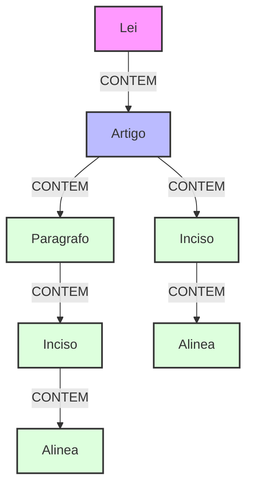

# LegisGraph Populator

The **Graph Populator** is the component responsible for ingesting processed JSON data into the Neo4j graph database. It transforms hierarchical legal documents into a connected graph structure.

O **Graph Populator** é o componente responsável por ingerir os dados JSON processados no banco de dados de grafos Neo4j. Ele transforma documentos legais hierárquicos em uma estrutura de grafo conectada.

## 📊 Graph Schema / Schema do Grafo



---

## 🇺🇸 English Documentation

### 📋 Prerequisites
- **Go** 1.25+
- **Neo4j** (Running via Docker is recommended, see `docker-compose.yml` in project root)
- **Processed Data**: JSON files generated by `legal-parser` (default: `../legal-parser/parsed_data`)

### ⚙️ Configuration
The project uses a `.env` file. You can check `.env.example` for reference.

| Variable | Description | Default |
|----------|-------------|---------|
| `NEO4J_URI` | Neo4j Connection URI | `bolt://localhost:7687` |
| `NEO4J_USERNAME` | Database User | `neo4j` |
| `NEO4J_PASSWORD` | Database Password | `minhasenha123` |
| `DATA_DIR` | Path to JSON files | `../legal-parser/parsed_data` |

### 🚀 How to Run

1.  **Start Neo4j**:
    ```bash
    # From project root
    docker-compose up -d neo4j
    ```
2.  **Run Populator**:
    ```bash
    cd graph-populator
    go run cmd/populator/main.go
    ```
3.  **Verify Data**:
    ```bash
    go run cmd/verifier/main.go
    ```

---

## 🇧🇷 Documentação em Português

### 📋 Pré-requisitos
- **Go** 1.25+
- **Neo4j** (Recomendado via Docker, veja `docker-compose.yml` na raiz)
- **Dados Processados**: Arquivos JSON gerados pelo `legal-parser` (padrão: `../legal-parser/parsed_data`)

### ⚙️ Configuração
O projeto utiliza um arquivo `.env`. Veja `.env.example` como referência.

| Variável | Descrição | Padrão |
|----------|-----------|--------|
| `NEO4J_URI` | URI de conexão Neo4j | `bolt://localhost:7687` |
| `NEO4J_USERNAME` | Usuário do Banco | `neo4j` |
| `NEO4J_PASSWORD` | Senha do Banco | `minhasenha123` |
| `DATA_DIR` | Caminho dos JSONs | `../legal-parser/parsed_data` |

### 🚀 Como Rodar

1.  **Inicie o Neo4j**:
    ```bash
    # Na raiz do projeto
    docker-compose up -d neo4j
    ```
2.  **Execute o Populator**:
    ```bash
    cd graph-populator
    go run cmd/populator/main.go
    ```
3.  **Verifique os Dados**:
    ```bash
    go run cmd/verifier/main.go
    ```
