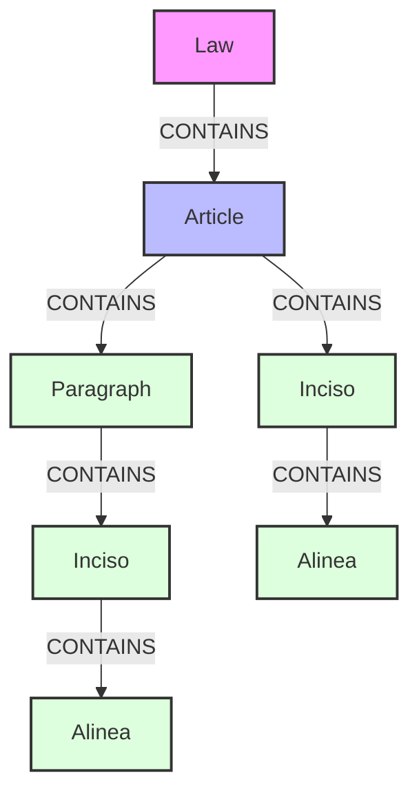

# LegisGraph Populator

> **Component Reference / Referência do Componente**
>
> *Part of the LegisGraph TCC Project*

## 🌍 Language Selection / Seleção de Idioma

Please select your preferred language:
Por favor, selecione seu idioma:

- [🇺🇸 **English Version**](#-english-version)
- [🇧🇷 **Versão em Português**](#-versão-em-português)

---

<a name="english-version"></a>
## 🇺🇸 English Version

### 📖 Overview
The **Graph Populator** is the ETL (Extract, Transform, Load) component responsible for ingesting processed JSON data into the Neo4j graph database. It transforms hierarchical legal documents into a strictly typed, connected graph structure, establishing the foundation for complex legal reasoning.

### 📊 Graph Schema
The database schema follows a strict vertical hierarchy to represent the structure of a Law.



### 🛠️ Technical Prerequisites
- **Go Runtime**: Version 1.25 or higher.
- **Database**: Neo4j (Community or Enterprise), version 4.4+ recommended.
- **Input Data**: Standardized JSON files generated by the `legal-parser` module.

### ⚙️ Configuration
The application is configured via environment variables, supporting `dotenv` for local development.

| Variable | Description | Default Value |
|----------|-------------|---------------|
| `NEO4J_URI` | Database Connection URI | `bolt://localhost:7687` |
| `NEO4J_USERNAME` | Authentication User | `neo4j` |
| `NEO4J_PASSWORD` | Authentication Password | `minhasenha123` |
| `DATA_DIR` | Input JSON Directory | `../legal-parser/parsed_data` |

### 🚀 Execution Guide

#### 1. Database Initialization
Ensure the Neo4j instance is active. A Docker Compose configuration is provided at the project root:

```bash
docker-compose up -d neo4j
```

#### 2. Running the Populator
To ingest the data, execute the main entry point:

```bash
cd graph-populator
go run cmd/populator/main.go
```

#### 3. Data Verification
A verification tool is included to validate the integrity and depth of the ingested graph:

```bash
go run cmd/verifier/main.go
```

---

<a name="versão-em-português"></a>
## 🇧🇷 Versão em Português

### 📖 Visão Geral
O **Graph Populator** é o componente de ETL (Extração, Transformação e Carga) responsável por ingerir os dados JSON processados no banco de dados de grafos Neo4j. Ele transforma documentos legais hierárquicos em uma estrutura de grafo estritamente tipada, estabelecendo a fundação para o raciocínio jurídico complexo.

### 📊 Schema do Grafo
O schema do banco de dados segue uma hierarquia vertical estrita para representar a estrutura de uma Lei.


### 🛠️ Pré-requisitos Técnicos
- **Runtime Go**: Versão 1.25 ou superior.
- **Banco de Dados**: Neo4j (Community ou Enterprise), versão 4.4+ recomendada.
- **Dados de Entrada**: Arquivos JSON padronizados gerados pelo módulo `legal-parser`.

### ⚙️ Configuração
A aplicação é configurada via variáveis de ambiente, com suporte a `dotenv` para desenvolvimento local.

| Variável | Descrição | Valor Padrão |
|----------|-----------|--------------|
| `NEO4J_URI` | URI de Conexão do Banco | `bolt://localhost:7687` |
| `NEO4J_USERNAME` | Usuário de Autenticação | `neo4j` |
| `NEO4J_PASSWORD` | Senha de Autenticação | `minhasenha123` |
| `DATA_DIR` | Diretório de Entrada JSON | `../legal-parser/parsed_data` |

### 🚀 Guia de Execução

#### 1. Inicialização do Banco
Certifique-se de que a instância do Neo4j esteja ativa. Uma configuração Docker Compose é fornecida na raiz do projeto:

```bash
docker-compose up -d neo4j
```

#### 2. Executando o Populator
Para ingerir os dados, execute o ponto de entrada principal:

```bash
cd graph-populator
go run cmd/populator/main.go
```

#### 3. Verificação de Dados
Uma ferramenta de verificação está incluída para validar a integridade e profundidade do grafo ingerido:

```bash
go run cmd/verifier/main.go
```
